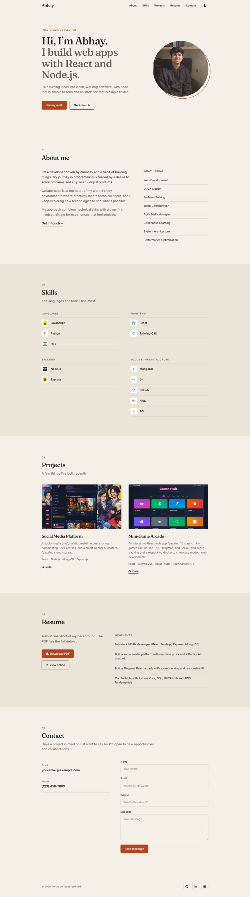
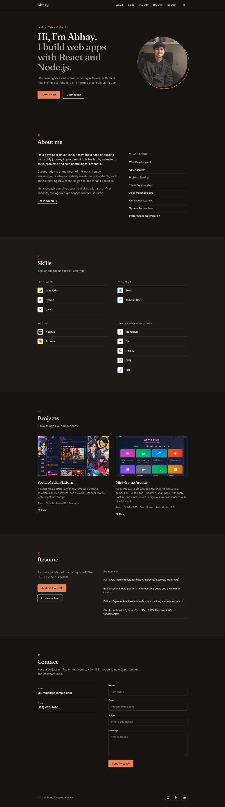
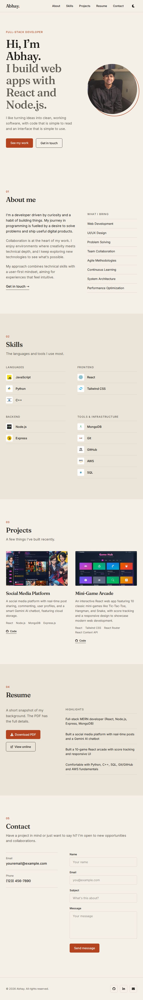
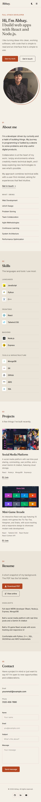
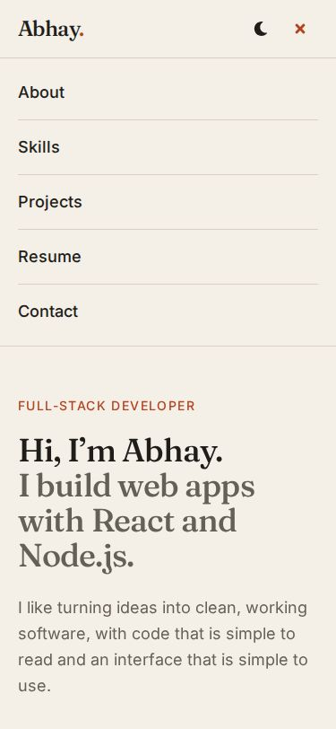

<div align="center">

# Abhay's Portfolio

A fast, responsive personal portfolio built with React, Vite and Tailwind CSS.

**[Live site](#)** &nbsp;·&nbsp; **[GitHub repository](https://github.com/AbhayCodes-dev/Personal-Portfolio-Website)**

<sub>Replace the "Live site" link with your deployed URL once it is online.</sub>

<br />



</div>

---

## Contents

1. [About the project](#about-the-project)
2. [Screenshots](#screenshots)
3. [Assignment checklist](#assignment-checklist)
4. [Getting started](#getting-started)
5. [Customising the content](#customising-the-content)
6. [How it is optimised](#how-it-is-optimised)
7. [Production build](#production-build)
8. [Deployment](#deployment)
9. [Testing](#testing)
10. [Challenges and solutions](#challenges-and-solutions)

---

## About the project

This is my personal portfolio. It shows who I am, what I can do and what I have built, and it is meant to load quickly and look good on any screen.

**Sections:** Home, About, Skills, Projects, Resume and Contact, plus a footer with social links.

**Highlights**

- Clean, flat design with a warm paper-and-ink palette, one accent colour and a matching dark theme
- Responsive from small phones to wide desktops
- Resume section with a downloadable PDF
- Contact form with validation that sends email through EmailJS
- Lazy-loaded images and components for a fast first load
- Keyboard friendly: skip link, visible focus outlines, labelled buttons and form fields

**Built with:** React 19, Vite 6, Tailwind CSS 4, React Hook Form, EmailJS, react-icons, and the Inter and Fraunces fonts (self-hosted).

---

## Screenshots

**Dark theme**



**Tablet and mobile**

<table>
  <tr>
    <td align="center" valign="top"><br /><sub>Tablet (768px)</sub></td>
    <td align="center" valign="top"><br /><sub>Mobile (375px)</sub></td>
    <td align="center" valign="top"><br /><sub>Mobile menu</sub></td>
  </tr>
</table>

---

## Assignment checklist

**Build**

- [x] Frontend built with React components (`src/components/`)
- [x] Sections: About Me, Projects, Skills, Resume, Contact
- [x] Responsive layout, checked at 320, 375, 768, 1280 and 1440 px with no sideways scrolling

**Optimise**

- [x] **Lazy loading for images**: `LazyImage` only requests an image when it is close to the screen. On first load only the hero photo is fetched (1 of 15 images).
- [x] **Lazy loading for components**: `React.lazy` and `Suspense` split About, Skills, Projects, Resume, Contact and Footer into separate chunks
- [x] **Minified JavaScript and CSS**: Vite production build

**Build and verify**

- [x] Production build created with `npm run build`
- [x] Build checked locally with `npm run preview`

**Deploy and test** (to be completed on the live site)

- [ ] Deployed on Vercel, Netlify or GitHub Pages
- [ ] Custom domain and SSL configured
- [ ] Deployed site tested in several browsers and on real devices (see [Testing](#testing))

**Submit**

- [ ] GitHub repository link submitted
- [x] README with process, challenges and solutions (this file)
- [x] Screenshots included (add the live link too once deployed)

---

## Getting started

You need [Node.js](https://nodejs.org/) 18 or newer.

```bash
npm install
npm run dev
```

Then open http://localhost:5173.

The contact form works out of the box. To use your own EmailJS account, copy `.env.example` to `.env` and fill in `VITE_EMAILJS_SERVICE_ID`, `VITE_EMAILJS_TEMPLATE_ID` and `VITE_EMAILJS_PUBLIC_KEY`.

---

## Customising the content

All the text and links live in a few small files, so you rarely need to touch the components.

| What to change | File |
| --- | --- |
| Email, phone, resume file name | `src/assets/data/site.js` |
| Social links (GitHub, LinkedIn, email) | `src/assets/data/social.js` |
| Project cards | `src/assets/data/projects.js` |
| Skills and icons | `src/assets/data/skills.js` |
| Resume highlights, experience, education | `src/assets/data/resume.js` |
| Resume PDF | `public/Abhay_Resume.pdf` (keep the same file name) |
| Colours | CSS variables at the top of `src/index.css` |

<details>
<summary>Project structure</summary>

```
src/
├── App.jsx              Layout, theme handling, lazy-loaded sections
├── index.css            Colour palette and base styles
├── components/
│   ├── Navbar.jsx       Sticky header, active link, theme toggle, mobile menu
│   ├── Hero.jsx
│   ├── About.jsx
│   ├── Skills.jsx
│   ├── Projects.jsx
│   ├── Resume.jsx
│   ├── Contact.jsx
│   ├── Footer.jsx
│   ├── Section.jsx      Shared section heading and spacing
│   ├── Reveal.jsx       Fade-in on first scroll into view
│   └── LazyImage.jsx    Image that loads only when near the viewport
└── assets/
    ├── data/            Content files listed above
    └── images/          Optimised WebP images
public/                  Resume PDF and favicon
```

</details>

---

## How it is optimised

| What | How |
| --- | --- |
| **Lazy-loaded images** | An `IntersectionObserver` gives each image its `src` only when it is within 300px of the screen. Width and height are set so the page does not jump as images appear. The hero photo is the one exception: it loads straight away with high priority. |
| **Lazy-loaded components** | Each section below the hero is its own JavaScript chunk, so the first bundle stays small and the hero appears quickly. |
| **Smaller images** | Everything converted to WebP and resized: about 1.8 MB of originals became about 130 KB. |
| **Minified code** | Vite minifies the JavaScript and CSS and removes unused code. |
| **Few dependencies** | No animation or scroll library. Smooth scrolling and fade-ins use plain CSS and the browser's own APIs. |
| **Good caching** | React is in its own chunk and every file name includes a hash, so browsers and hosts can cache files for a long time. |
| **Fast fonts** | Fonts are bundled with the site and split by language, so visitors only download the Latin files. |

**Build size (gzipped):** main JavaScript about 7 kB, React about 59 kB, CSS about 5 kB. The section chunks are between 1 and 11 kB each; the contact form is the largest because of the form and email libraries.

---

## Production build

```bash
npm run lint       # check the code
npm run build      # create the optimised build in dist/
npm run preview    # serve the build at http://localhost:4173
```

Always check the site with `npm run preview` before deploying. It serves the same files your host will serve.

---

## Deployment

### 1. Push the code to GitHub

```bash
git add .
git commit -m "Update portfolio"
git push origin master
```

Use `main` instead of `master` if that is your branch name.

### 2. Choose a host

Vercel is the quickest option. Netlify and GitHub Pages work too, and the config files for all three are already in the project.

<details open>
<summary><b>Vercel (recommended)</b></summary>

1. Go to https://vercel.com/new and import the GitHub repository.
2. Vercel detects Vite automatically (build command `npm run build`, output folder `dist`).
3. Click **Deploy**. You get a `https://<project>.vercel.app` address with HTTPS.
4. **Custom domain and SSL:** open the project, go to **Settings → Domains**, add your domain and create the DNS record Vercel shows (an A record or CNAME). The SSL certificate is issued and renewed automatically.

</details>

<details>
<summary><b>Netlify</b></summary>

1. Go to https://app.netlify.com and choose **Add new site → Import from Git**, then pick the repository. Settings are read from `netlify.toml`.
2. Click **Deploy**.
3. **Custom domain and SSL:** open **Domain management → Add domain** and follow the DNS instructions. HTTPS is enabled automatically.

</details>

<details>
<summary><b>GitHub Pages</b></summary>

1. In the repository, go to **Settings → Pages** and set the source to **GitHub Actions**.
2. Push to `master` or `main`. The workflow in `.github/workflows/deploy.yml` builds the site and publishes it to `https://<username>.github.io/Personal-Portfolio-Website/`.
3. **Custom domain and SSL:** set the domain under **Settings → Pages → Custom domain**, then tick **Enforce HTTPS**.

</details>

### 3. After deploying

Add the live URL at the top of this README and to your assignment submission.

---

## Testing

### Automated checks

I ran these against the production build in headless Chromium (Playwright):

- All sections render, with no broken images and no console errors
- No sideways scrolling at 320, 375, 768, 1280 and 1440 px
- Lazy loading: only 1 of 15 images has loaded on first paint, and all 15 load while scrolling
- Navigation links scroll to the right section, the active link highlights, and the mobile menu closes after a tap
- The contact form shows validation messages for empty fields
- The theme toggle works and the choice is remembered after a reload

### Manual checks on the deployed site

Fill this in after deploying.

| Browser or device | Works? | Notes |
| --- | :---: | --- |
| Chrome (desktop) | | |
| Firefox | | |
| Safari | | |
| Edge | | |
| Android phone | | |
| iPhone | | |

Also check that the contact form sends a real email, the resume downloads, and every project link opens.

---

## Challenges and solutions

**Images worked in development but not in the production build.**
They were referenced as plain text paths such as `/src/assets/...`, which Vite does not bundle. I switched every image to an `import` so Vite includes and fingerprints it.

**Some files were missing.**
The social icons and one project image did not exist. I replaced the icons with `react-icons` and removed the unfinished "Weather Dashboard" card, which had placeholder links and no image.

**File names would have broken on a Linux host.**
`Express.png` and `express.png` are the same file on Windows and macOS but not on Linux. I renamed everything to lowercase.

**The images were too heavy.**
About 1.8 MB of PNG and JPG files (the profile "jpg" was actually a PNG). I resized them and converted them to WebP, bringing the total to about 130 KB.

**Small icons were being embedded into the JavaScript.**
Vite inlines small files as base64 by default, which defeats lazy loading. Setting `assetsInlineLimit: 0` keeps each image as its own file.

**Browser lazy loading was not lazy enough.**
With only `loading="lazy"`, 12 of 15 images were requested before any scrolling on a tall phone page, because each browser decides how far ahead to load. I added an `IntersectionObserver` in `LazyImage`, so now only 1 of 15 loads up front.

**The first design looked generic.**
It leaned on gradients, glows and blur. I rebuilt the interface with a solid colour palette stored as CSS variables, and replaced the animation library with a small fade-in component.

**Side-sliding animations caused sideways scrolling on phones.**
The fade-ins now move only vertically, so nothing sits outside the screen.

**Dark-mode visitors saw a white flash while the page loaded.**
A tiny script in `index.html` applies the saved or system theme before the first paint.

**Tailwind v4 ignored the old config file.**
Tailwind v4 does not read `tailwind.config.js` and ties `dark:` to the system setting. I removed the unused file and added a `@custom-variant dark` rule so the theme toggle works.

---

## Author

Built by [Abhay](https://github.com/AbhayCodes-dev).
